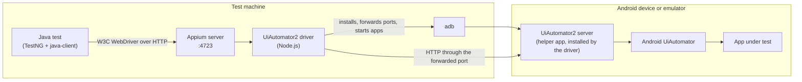

# Appium architecture

Appium is a **server** that speaks the W3C WebDriver protocol. The test talks HTTP to Appium; a platform **driver** turns the commands into what the mobile OS understands. Since Appium 2 the server has no drivers built in: each one is installed separately. This project pins both in `package.json`.

## What happens in one session

1. The test sends `POST /session` with **capabilities**: platform, driver, device, app.
2. The server picks the driver from `appium:automationName`.
3. The driver uses `adb` to find the device and installs the UiAutomator2 helper apps on it.
4. It forwards a port to the helper and starts the app.
5. Every command (`findElement`, `click`) is an HTTP request: test → Appium → driver → helper → Android.
6. `DELETE /session` ends it.

The first session on a new device is slow because of step 3. Later sessions reuse the installed helper.

## Capabilities used here

| Capability | Value | Meaning |
|---|---|---|
| `platformName` | `Android` | W3C standard, no prefix |
| `appium:automationName` | `UiAutomator2` | which driver |
| `appium:appPackage` | `com.android.settings` | the app to start, without installing an APK |
| `appium:appActivity` | `.Settings` | its first screen |
| `appium:noReset` | `true` | keep the app's data between sessions |
| `appium:newCommandTimeout` | `120` | end a session the test has forgotten |

Everything that is not a W3C standard capability needs the `appium:` prefix.

## Appium compared with Selenium

| | Selenium | Appium |
|---|---|---|
| Protocol | W3C WebDriver | W3C WebDriver (extended) |
| Talks to | a browser driver | a mobile driver and a helper on the device |
| Locators | CSS, XPath, id | accessibility id, resource id, UiAutomator, XPath |
| Session start | seconds | tens of seconds on a new device |
| Extra | — | gestures, app lifecycle, device settings, contexts |

**Locator order of preference:** accessibility id → resource id → UiAutomator selector → XPath (the slowest and the most fragile).
